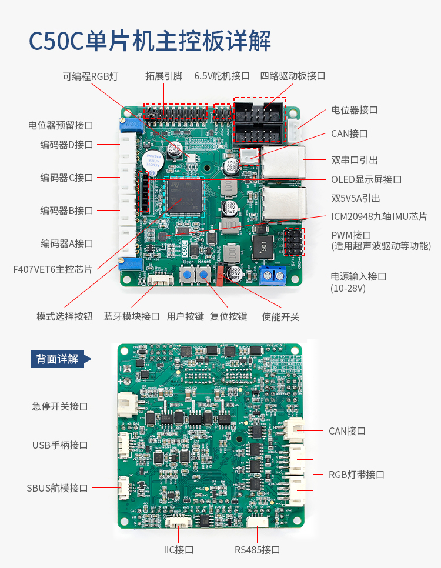

# C50C 两轮差速底盘

基于轮趣科技源码，适配现有四轮两驱底盘。



*原厂接口图；接线以V4.3原理图和实物为准。*

## 硬件与参数

| 项目 | 配置 / 状态 |
|---|---|
| 控制板 | C50C V4.3，STM32F407VET6 |
| 内存 | Flash 512 KiB；SRAM 128 KiB＋CCM 64 KiB |
| IMU / 显示 | ICM20948 / 原配六针OLED |
| 电机驱动 | 现有双通道驱动板，PWM＋方向信号 |
| 底盘 | 两主动轮＋两从动全向轮 |
| 主动轮直径 | 手册标称8寸（203.2 mm），待标定 |
| 减速比 / 编码器 | 当前按28∶1 / 500线；四倍频56000次/轮圈 |
| 轮距 / PI | 轮距待测；KP=300、KI=300，待调参 |
| 板输入电压 | 板图标称10～28 V；固件普通模式低于20 V失能 |

## 当前状态

- `main`：源码基线；`Eggy`：底盘适配。
- 初步适配已编译通过、主机测试通过，未完成实机验证。
- 轮距未填写，默认关闭电机输出，OLED显示 `CFG REQUIRED`。
- 编码器供电需核对：旧底板5 V，C50C接口3.3 V。

## 开发入口

| 入口 | 用途 |
|---|---|
| [USER/WHEELTEC.uvprojx](USER/WHEELTEC.uvprojx) | Keil工程，选择 `Diff_Car`；当前Compiler 5.06 update 5 |
| [eggy_chassis_config.h](CarType/Inc/eggy_chassis_config.h) | 底盘参数与方向配置 |
| `USER/` / `BALANCE/` / `HARDWARE/` | 初始化 / 控制与通信 / 硬件驱动 |
| [AGENTS.md](AGENTS.md) | 协作约定 |
| [底盘适配说明](docs/Eggy底盘适配说明.md) | 接线、参数依据与待验证项 |
| [CodeGraph工作流](docs/CodeGraph工作流.md) | 查询、影响分析与索引同步 |

技术栈：C＋STM32标准外设库＋FreeRTOS，Keil工程。

```powershell
codegraph sync .  # 首次使用：codegraph init --yes .
python tests/test_eggy_profile.py
```
