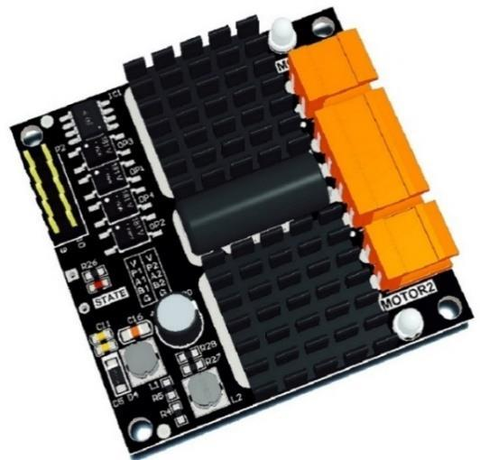
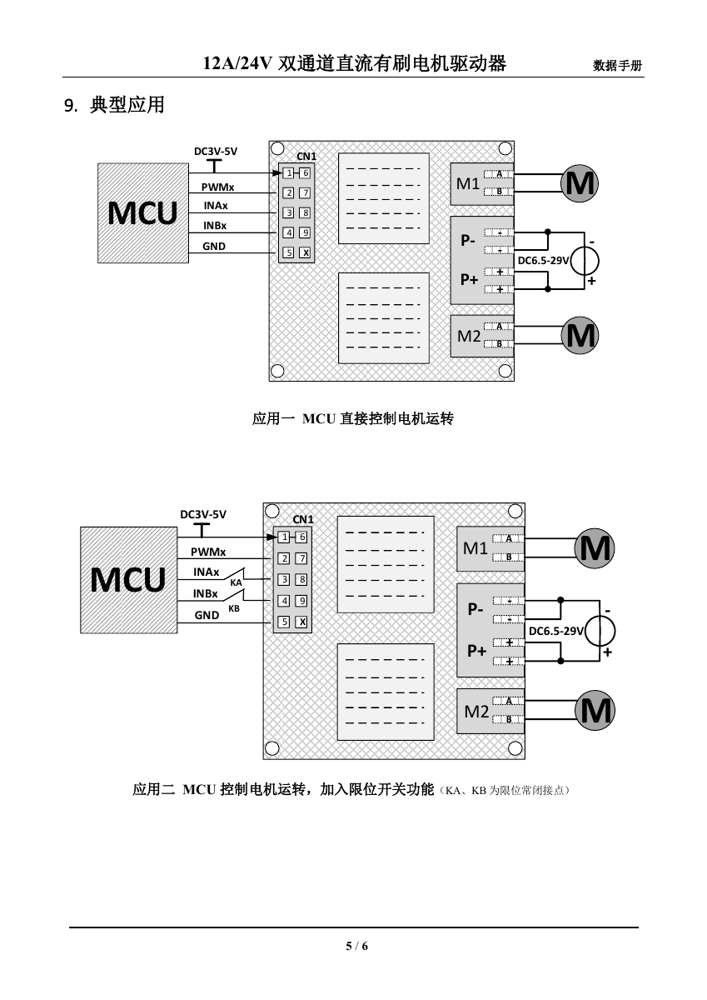
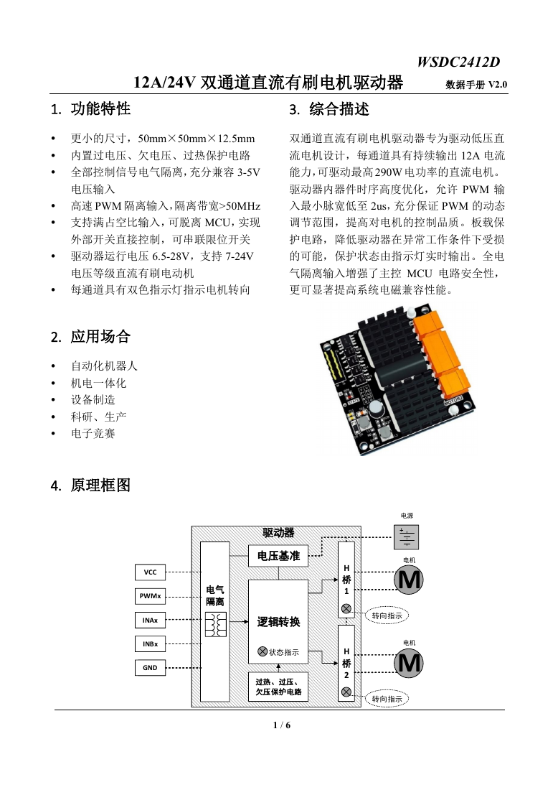

# C50C 两轮差速底盘

基于轮趣科技源码，适配现有四轮两驱底盘。


*原厂接口图；接线以V4.3原理图和实物为准。*

## 硬件与参数

| 项目 | 配置 / 状态 |
|---|---|
| 控制板 | C50C V4.3，STM32F407VET6 |
| 内存 | Flash 512 KiB；SRAM 128 KiB＋CCM 64 KiB |
| IMU / 显示 | ICM20948 / 原配六针OLED |
| 电机驱动 | 资料型号WSDC2412D（待核对实物），双通道PWM＋方向信号 |
| 底盘 | 两主动轮＋两从动全向轮 |
| 主动轮直径 | 手册标称8寸（203.2 mm），待标定 |
| 减速比 / 编码器 | 当前按28∶1 / 500线；四倍频56000次/轮圈 |
| 轮距 / PI | 轮距550 mm（用户实测）；KP=300、KI=300，待调参 |
| 板输入电压 | 板图标称10～28 V；固件普通模式低于20 V失能 |

## 驱动板与接线



| WSDC2412D手册参数 | 数值 |
|---|---|
| 功率输入 / 持续输出 | 6.5～28 V / 每通道12 A（手册测试条件） |
| 控制接口 | PWM、INA、INB；逻辑输入3～5.5 V |
| 尺寸 | 50×50×12.5 mm |

下表是当前源码的拟接线，尚未实机验证；CN1编号按驱动手册。

| C50C信号 | WSDC2412D CN1 |
|---|---|
| 左轮A：PC9 / PB13 / PB12 | 2 PWM1 / 3 INA1 / 4 INB1 |
| 右轮B：PC8 / PC0 / PE15 | 7 PWM2 / 8 INA2 / 9 INB2 |
| 控制侧3.3 V / GND | 1、6 VCC / 5、10 GND（10在图中标为X） |
| 电池正、负极 | 功率端P+、P− |
| 左、右电机 | 功率端M1、M2 |

编码器：左轮接PA15/PB3，右轮接PA6/PA7。OLED沿用C50C原配六针接口。编码器电源、电平和各插头顺序需按实物核对。

<details>
<summary>驱动器典型接线图与原理框图（手册原页）</summary>





接线图标注6.5～29 V，与参数表不一致；使用上限按参数表28 V。

</details>

## 原理图与手册

| 资料 | 图片预览 | 原始PDF |
|---|---|---|
| C50C V4.3原理图 | [查看4页原理图](docs/hardware/README.md) | [PDF](https://raw.githubusercontent.com/liueggy/c50c-diff-chassis/Eggy/docs/hardware/C50C_V4.3_%E5%8E%9F%E7%90%86%E5%9B%BE.pdf) |
| C50C V4.3资源分配 | [查看资源表](docs/hardware/README.md#资源分配) | [PDF](https://raw.githubusercontent.com/liueggy/c50c-diff-chassis/Eggy/docs/hardware/C50C_V4.3_%E8%B5%84%E6%BA%90%E5%88%86%E9%85%8D.pdf) |
| WSDC2412D手册 | [接线图](docs/images/wsdc2412d-wiring.png) / [原理框图](docs/images/wsdc2412d-overview.png) | [PDF](https://raw.githubusercontent.com/liueggy/c50c-diff-chassis/Eggy/docs/hardware/WSDC2412D_%E6%95%B0%E6%8D%AE%E6%89%8B%E5%86%8C_V2.0.pdf) |

驱动器资料提供原理框图，未提供完整元件级原理图。

更多资料集中在 [C50C 开发与外围硬件手册](docs/manuals/README.md)：底盘开发、UART/CAN 协议、STM32F407 数据手册与 RM0090、ICM20948、CH9102F、CAN 收发器、D50A 和 OLED。索引标明适用版本、用途和资料缺口，PDF 可直接下载，克隆后也可按相对路径查阅。

## 当前状态

- `main`：源码基线；`Eggy`：底盘适配。
- 初步适配已编译通过、主机测试通过，未完成实机验证。
- 轮距已填入550 mm；电气配置尚未确认，仍关闭电机输出，OLED显示 `CFG REQUIRED`。
- `Eggy` 的 RGB 灯按红、橙、黄、绿、青、蓝、紫依次呼吸，每色约4秒；灯效与电机输出门控独立。
- 编码器供电需核对：旧底板5 V，C50C接口3.3 V。

## 开发入口

| 入口 | 用途 |
|---|---|
| [USER/WHEELTEC.uvprojx](USER/WHEELTEC.uvprojx) | Keil工程，选择 `Diff_Car`；当前Compiler 5.06 update 5 |
| [eggy_chassis_config.h](CarType/Inc/eggy_chassis_config.h) | 底盘参数与方向配置 |
| `USER/` / `BALANCE/` / `HARDWARE/` | 初始化 / 控制与通信 / 硬件驱动 |
| [AGENTS.md](AGENTS.md) | 协作约定 |
| [底盘适配说明](docs/Eggy底盘适配说明.md) | 接线、参数依据与待验证项 |
| [CodeGraph工作流](docs/CodeGraph工作流.md) | 查询、影响分析与索引同步 |

技术栈：C＋STM32标准外设库＋FreeRTOS，Keil工程。

```powershell
codegraph sync .  # 首次使用：codegraph init --yes .
python tests/test_eggy_profile.py
```
